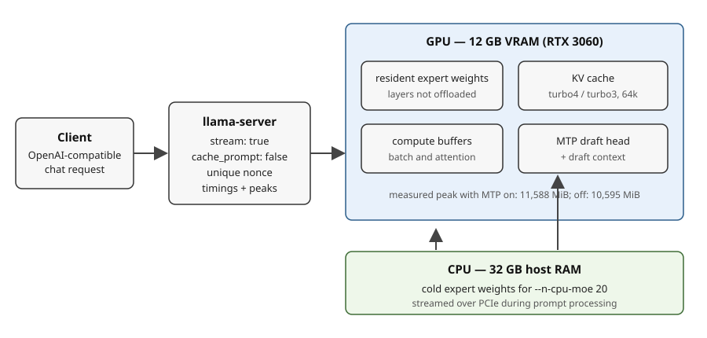
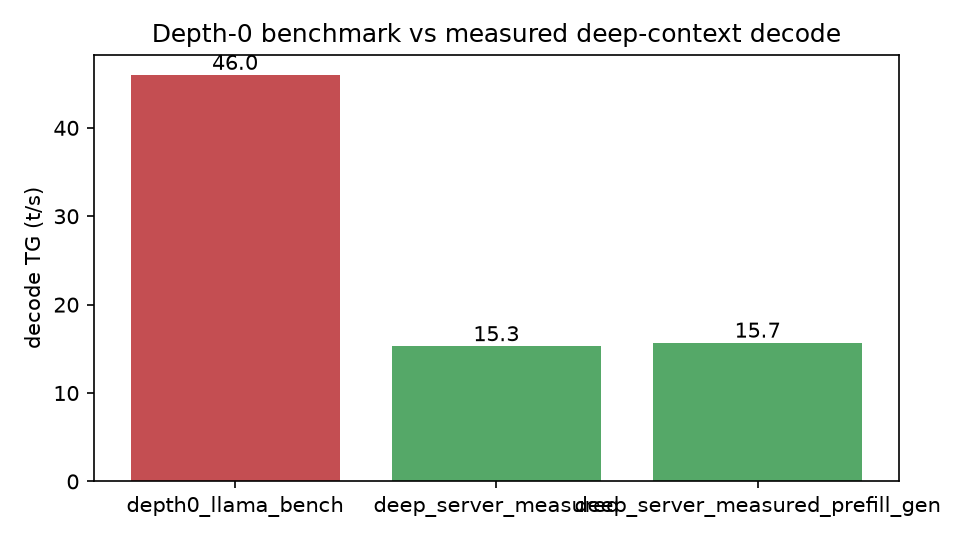
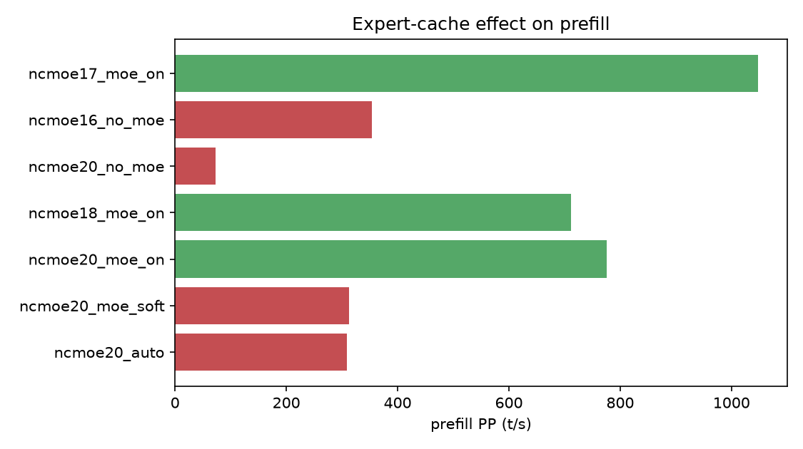
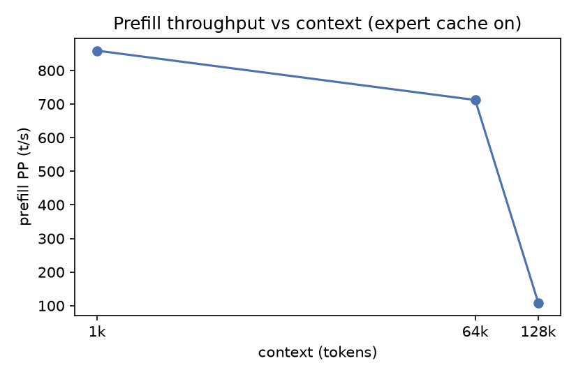
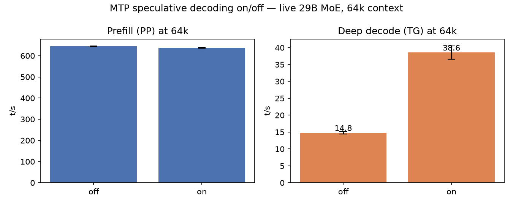
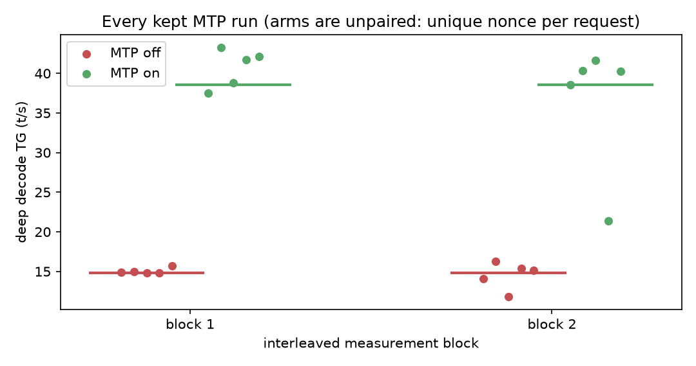
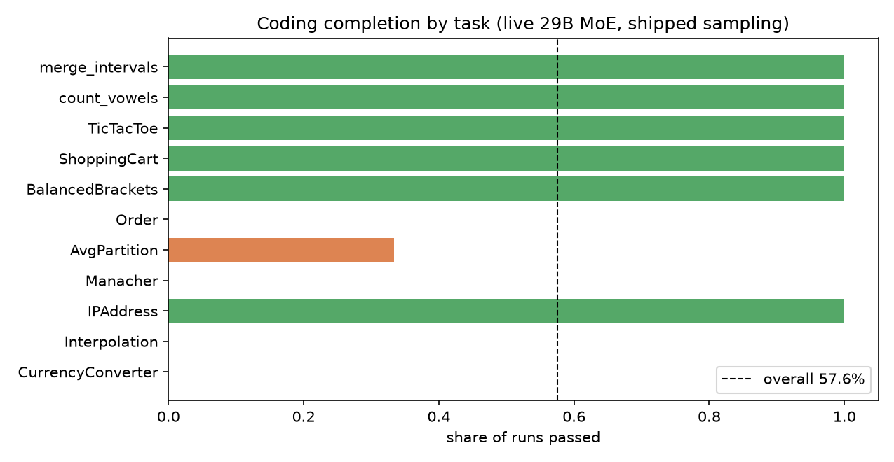

# Long-Context Local LLM Inference on a 12 GB RTX 3060: Measuring MTP, Prefill, and VRAM at 64k

*An engineering study of a 29B-class Mixture-of-Experts model on a single consumer GPU*

## Abstract

This study examines long-context inference for a **29B Mixture-of-Experts** model (*Qwen 29B REAP*) on a single **RTX 3060** with **12 GB** of **VRAM**. In the context of agentic use, the practical question is not how fast the model generates with an empty context, but what happens when a request arrives with tens of thousands of tokens already in the prompt. The experiments therefore measure the serving path: long-context prefill, subsequent decode, memory pressure, and the serving parameters that affect each stage.

In the primary **64k-context** configuration, using approximately **57.9k-token prompts**, multi-token prediction (*MTP*) increased deep-context decode from **14.79** to **38.56 tokens/s** (*+160.7%*), with an estimated difference of **+23.77 tokens/s** (*95% CI: ±4.58 tokens/s; n = 10 per arm*). Prefill was **645.1 tokens/s** vs **637.4 tokens/s** (*-1.19%*), showing no material change in this experiment. The configuration used an additional **+993 MiB of peak VRAM** and about **+1.7 GiB of peak host RAM**; both are measured increases in per-run peak memory.

Additional experiments on a related **28B MoE** model (*Qwen 28B REAP*) show a different pattern: an MoE expert cache raised short-context prefill from **308.5** to **775.7 tokens/s** while deep decode stayed around **14–15 tokens/s**. A separate depth-0 benchmark reported **46.0 tokens/s** versus **15.3 tokens/s** after a full **64k prompt**. The **46.0 tokens/s** and **15.3 tokens/s** are not directly comparable; the **~3x** is a measured illustration on a related model, not a controlled ratio.

These measurements characterize **one model**, **one host**, **one runtime**, **one context length** and **one prompt family**.

They are not universal performance estimates.

## I. Introduction

The practical question was simple: with 12 GB of VRAM, how much performance can be recovered from a 29B-class MoE model at 64k context, and which serving parameters actually matter? The experiments follow the request path used by a long-context agent: prefill a large history, then generate from it.

The study has two tracks, and their results are never pooled:

| Track | Model | Experiments |
|---|---|---|
| **Primary** | Live `Qwen3.6-29B-REAP-Opus-Reasoning-Distill-MTP`, Q4_K_M | MTP on/off A/B, `ncmoe` load probes, coding evaluation |
| **Supporting** | 28B benchmark sibling | Depth-0 baseline, expert-cache comparison, context sweep |

Each section states which track it uses. The primary configuration is:

| Component | Configuration |
|---|---|
| GPU | NVIDIA RTX 3060, 12 GB (12,288 MiB) |
| CPU | Intel i7-9700K, 8 cores / 8 threads |
| RAM | 32 GB |
| OS | Arch Linux |
| GPU driver | 615.78.08 |
| GPU power limit | 170 W |
| Model | `Qwen3.6-29B-REAP-Opus-Reasoning-Distill-MTP`, Q4_K_M |
| Architecture | Sparse Mixture-of-Experts, ~29B total parameters |
| Context | 65,536 tokens |
| Prompt length | ~57.9k tokens in the MTP A/B |
| Expert offload | `--n-cpu-moe 20` |
| MTP experiment | off vs `--spec-type draft-mtp --spec-draft-n-max 2` |
| KV cache | `turbo4` (K) / `turbo3` (V) |
| Expert cache | `--moe-cache on` for the MTP-on profile |
| Runtime | `llama.cpp` KV-cache fork |
| Runtime revision | `bcb85fc3ae85efa0f5f392c6c880dfc524923860` |

The full host configuration and serving flags are documented in
[HARDWARE-AND-RUNTIME.md](HARDWARE-AND-RUNTIME.md).



**Figure 1 — Tested serving path and memory split.**
*Schematic: the request path and measured memory split, not a data plot. On the tested host, MTP-on reached 11,588 MiB peak VRAM versus 10,595 MiB with MTP off. Exact flags: [HARDWARE-AND-RUNTIME.md](HARDWARE-AND-RUNTIME.md).*

Raw traces, table provenance and per-claim status are documented in
[EVIDENCE.md](EVIDENCE.md). Every table in this article is regenerated from
committed inputs by the supplied scripts.

## II. Depth-0 throughput and the long-context gap

`llama-bench` is useful for measuring baseline generation throughput, but its token-generation measurement starts at depth 0: there is no large conversation history in front of the model.

That is a useful measurement when the question is:

> How quickly can this model generate when there is no existing context?

It is a different question from:

> How quickly can this serving configuration generate after processing a 64k-token request?

In the available 28B benchmark-sibling comparison:

| Measurement | Decode throughput |
|---|---:|
| `llama-bench` token generation, depth 0 | **<!-- claim:depth0_tg -->46.0<!-- /claim --> t/s** |
| After a full 64k prompt | **<!-- claim:deep_tg -->15.3<!-- /claim --> t/s** |



**Figure 2 — Depth-0 vs deep-context decode.**
*Data: [deep_vs_depth0.csv](results/deep_vs_depth0.csv) · source rows: [data/sources-bench.json](data/sources-bench.json) §06/§07 · supporting track: 28B benchmark sibling. The depth-0 row is `llama-bench`; the deep row is a server request. The two rows do not carry a matched VRAM reading.*

In this comparison, the depth-0 result is roughly **3× higher** than the observed deep-context decode rate.

That does not make depth-0 benchmarking useless. It means that it should not be used as a proxy for the full request path when the workload routinely carries a large context. For an agentic workload, the relevant sequence is closer to:

```text
Large prompt
    ↓
Prefill
    ↓
Long-context state
    ↓
Decode
```

A benchmark that measures only the final step starting from an empty context leaves out much of the workload.

There is a similar issue with very small prompts. A 25-token request in this setup carries approximately 62 ms of fixed per-request overhead, so its apparent tokens-per-second number is dominated by overhead rather than by the behavior of a long-context prefill.

For this reason, the measurements below use the actual server request path wherever possible.

## III. Measurement protocol

The primary measurements use the server's OpenAI-compatible request path rather than a synthetic token-generation loop.

The protocol is deliberately simple:

- `POST /v1/chat/completions`
- `stream: true`
- tool schemas offered to the server
- `cache_prompt: false`
- a unique nonce per request
- `cache_n == 0` on every retained run
- interleaved A/B arms
- warmups discarded
- at least five retained runs per arm
- all retained runs reported, including outliers
- mean and SEM reported
- VRAM, host RAM, GPU utilization, power and swap sampled per request

For the primary MTP comparison, the arms were interleaved in blocks:

```text
off → on → on → off
```

The block structure provides some protection against time-dependent drift while retaining independent requests for the two arms. The MTP experiment contains **10 retained runs per arm**, five per block.

A small-prompt smoke test and a depth-0 benchmark were not used as substitutes for the long-context measurement. Single-point measurements were also not used as the basis for the primary claims.

The complete protocol, including the comparison interval, is documented in
[METHODOLOGY.md](METHODOLOGY.md).

## IV. Expert cache and prefill

### A. Optimization of prefill

The first optimization target is prefill. This section uses the **28B benchmark sibling**, not the live 29B MTP profile.

When expert layers are kept on the CPU, the serving path has to access those experts during processing of the prompt. At long context, repeated expert access can become a substantial part of the prefill cost. The tested runtime provides an expert cache that uses spare VRAM to retain CPU-resident experts.

**Example at 1k context:**

| Configuration | Prefill |
|---|---:|
| `ncmoe=20`, cache off | **<!-- claim:cache_off -->308.5<!-- /claim --> t/s** |
| `ncmoe=20`, cache soft | 313.2 t/s |
| `ncmoe=20`, cache on | **<!-- claim:cache_on -->775.7<!-- /claim --> t/s** |



**Figure 3 — Expert-cache effect on prefill.**
*Data: [moe_cache.csv](results/moe_cache.csv) · source rows: [data/sources-bench.json](data/sources-bench.json) §04 · supporting track: 28B benchmark sibling at 1k context. The source ledger is hand-transcribed; its provenance is documented in [EVIDENCE.md](EVIDENCE.md).*

The cache increased measured prefill by approximately **2.5×** in this comparison. The effect is much less useful for decode. Across the tested cache and `ncmoe` configurations, deep decode remained around **14–15 t/s**.

The distinction is important:

> **The expert cache is a prefill optimization in this study, not a deep-decode optimization.**

### B. Context length

Prefill also decreases as context grows, even when the configuration still fits in memory.

On the 28B benchmark sibling:

| Context | Prefill |
|---:|---:|
| 1k | 859 t/s |
| 64k | 712 t/s |
| 128k | <109 t/s |



**Figure 4 — Prefill throughput vs context.**
*Data: [prefill_vs_ctx.csv](results/prefill_vs_ctx.csv) · source rows: [data/sources-bench.json](data/sources-bench.json) §06 · supporting track: 28B benchmark sibling. The 64k no-cache point is a timeout upper bound rather than a completed measurement.*

Two constraints become visible here.

First, the cache needs spare VRAM. It reserves memory adaptively, so a configuration with insufficient headroom cannot simply enable it.

Second, context length itself becomes increasingly expensive during prefill. The 128k measurement is particularly slow even though the sibling configuration can fit the context.

The practical consequence is that **memory capacity and prefill throughput have to be considered together**.

## V. MTP at 64k (live 29B)

For deep-context decode, the tested optimization is **multi-token prediction (MTP) speculative decoding**.

The model provides a draft head. The runtime can use:

```text
--spec-type draft-mtp
--spec-draft-n-max 2
```

to propose multiple tokens before the main model verifies them.

The primary experiment compares MTP off and on using the same live 29B configuration.

### A. Results

| Metric | MTP off | MTP on (`n-max=2`) | Difference |
|---|---:|---:|---:|
| Retained runs | 10 | 10 | — |
| Prompt tokens, mean | 57,881 | 57,880 | — |
| Deep decode | **<!-- claim:mtp_tg_off -->14.79<!-- /claim --> t/s** | **<!-- claim:mtp_tg_on -->38.56<!-- /claim --> t/s** | **+<!-- claim:mtp_delta -->23.77<!-- /claim --> t/s (+<!-- claim:mtp_delta_pct -->160.7<!-- /claim -->%)** |
| Prefill | 645.10 t/s | 637.39 t/s | −1.19% |
| MTP acceptance | — | **<!-- claim:mtp_accept -->0.838<!-- /claim -->** | SD 0.070 |
| Peak VRAM | 10,595 MiB | 11,588 MiB | **+993 MiB** |



**Figure 5 — MTP on/off at 64k.**
*Data: [mtp_ab.csv](results/mtp_ab.csv), [mtp_comparison.csv](results/mtp_comparison.csv) · live 29B configuration, 10 retained runs per arm, approximately 57.9k-token prompts, cold prefill on every retained run.*

The run-level distribution is shown below.



**Figure 6 — Every kept MTP run.**
*Data: [mtp_runs.csv](results/mtp_runs.csv) · live 29B configuration. Each request used a unique nonce, so the two arms are independent rather than paired; the points show the full spread and the short lines are arm means.*

The measured decode rate increased from **14.79 to 38.56 t/s**, a gain of **160.7%**.

The corresponding prefill measurements changed by only **−1.19%**, which is inside the study's approximately 4% operational noise threshold.

MTP therefore produced a large measured change in decode without a comparable change in prefill.

The additional memory cost was approximately:

- **993 MiB peak VRAM**
- **1.7 GiB host RAM**

The MTP-on configuration reached 11,588 MiB of the available 12,288 MiB VRAM, leaving relatively little headroom.

### B. Difference interval

The difference interval is calculated as an **unpaired** interval. Each request has an independent nonce, so the observations are not paired even though the experiment uses interleaved blocks.

For the two arms:

- MTP off: SEM 0.38 t/s
- MTP on: SEM 1.99 t/s
- combined difference interval: approximately **±<!-- claim:mtp_ci_half -->4.58<!-- /claim --> t/s**

The interval uses a Welch standard error and the conservative multiplier `t(df=9)=2.262`; the Welch–Satterthwaite degrees of freedom are approximately 9.66.

The two experimental blocks moved in the same direction:

| Block | MTP off | MTP on | Difference |
|---|---:|---:|---:|
| Block 1 | 15.04 t/s | 40.69 t/s | +25.65 |
| Block 2 | 14.53 t/s | 36.42 t/s | +21.89 |

These block means are descriptive; they are not used as a separate block-level confidence interval.

### C. What the result means

The strongest conclusion is deliberately narrow:

> **On this exact 29B / RTX 3060 / 64k / runtime configuration, MTP with `n-max=2` produced a large increase in measured deep-context decode throughput.**

It does not establish that `n-max=2` is the optimal draft count, that the same percentage will occur on another GPU or model, or that another prompt will produce the same acceptance rate. Acceptance is content-dependent, so the prompt is part of the experimental configuration. The broader boundary conditions are in [LIMITATIONS.md](LIMITATIONS.md).

An earlier single-point observation put MTP-on decode near 30 t/s at approximately 54.6k prompt depth. The controlled A/B is the stronger evidence and supersedes that estimate as the principal measurement.

## VI. KV cache and configuration limits

### A. KV-cache quantization

The serving build used in this study supports quantized KV-cache types:

```text
turbo4
turbo3
```

The startup log also reports:

```text
TurboQuant rotation matrices initialized (128x128)
```

This establishes that the tested build contains the corresponding runtime implementation. KV-cache quantization is important to the configuration because reducing KV memory pressure helps make a 64k context possible within 12 GB of VRAM.

It was **not**, however, isolated as an independent throughput experiment. The study therefore does not establish a decode-throughput improvement attributable specifically to the KV-cache quantization settings. The appropriate interpretation is:

> **KV-cache quantization is part of the memory configuration that makes the workload fit; this study does not isolate its performance contribution.**

Startup evidence is retained in [data/raw/p4/probe-results.txt](data/raw/p4/probe-results.txt). Claims about the broader performance characteristics of the quantization method are outside the scope of this experiment.

### B. Memory limits and `ncmoe`

The serving parameters interact. An optimization measured on one configuration cannot automatically be transferred to another.

A smaller, non-MTP sibling configuration indicated that `ncmoe=17` was a useful operating point. On the live 29B MTP configuration, the same setting does not fit.

| Live 29B MTP load probe | `ncmoe` | Result |
|---|---:|---|
| Reference | 20 | **OK** |
| Candidate, cache on | 17 | **FAIL — OOM** |
| Control, cache off | 17 | **FAIL — OOM** |

The failures occurred while creating the MTP context:

- cache-on failed while allocating a 128 MiB KV-cache allocation;
- cache-off failed while allocating 208 MiB of compute buffers.

These are load probes, not throughput comparisons. The OOM traces are retained in [data/raw/p4/probe-results.txt](data/raw/p4/probe-results.txt).

The result illustrates an important practical property of constrained inference:

> **The best memory split is a property of the complete model/runtime configuration, not simply of the model.**

Adding MTP changes the memory requirements enough to invalidate a previously measured `ncmoe` setting.

### C. GPU utilization is not enough to identify the bottleneck

During deep generation, the GPU was observed at approximately:

- **82% utilization**
- **107 W**
- against a **170 W** power limit.

The GPU was therefore not fully saturated during the measured decode path.

This does not identify the remaining bottleneck. It only shows that utilization and power draw alone are insufficient to select the next optimization. A different kernel, runtime implementation, memory-access pattern, or architecture change could still affect decode performance.

The practical approach is consequently simple:

> **Measure the real request path, then optimize the resource that the measurement identifies.**

Configurations close to the VRAM limit deserve particular caution. A configuration that passes a smoke test with approximately 150 MiB of headroom may still be fragile. The `ncmoe=17` probe demonstrates the more important failure mode: infeasibility can appear during initialization, before throughput can be measured at all.

## VII. Recommended configurations

The measurements suggest three practical profiles.

| Profile | Context | Key settings | Measured result | Track |
|---|---:|---|---|---|
| **Agent default** | 64k | MTP on, expert cache on, `ncmoe=20` | 38.6 t/s decode, 637 t/s prefill, 11,588 MiB peak | Primary 29B |
| **Prefill-first** | 64k | Expert cache on | 308.5 → 775.7 t/s at 1k | Supporting 28B |
| **Maximum context** | 128k | Deeper CPU offload | Prefill below 109 t/s | Supporting 28B; not validated on live 29B |

### A. Agent default

**64k context · MTP · expert cache on**

```text
-c 65536
--n-cpu-moe 20
--spec-type draft-mtp
--spec-draft-n-max 2
--moe-cache on
```

This is the best-fitting configuration found for the live 29B profile:

- deep decode: **38.6 t/s**
- prefill: **637 t/s**
- peak VRAM: **11,588 MiB**
- additional host RAM for the draft context: approximately **1.7 GiB**

It is most appropriate for workloads that process long context and generate comparatively short responses.

### B. Prefill-first

**Keep the expert cache enabled.**

The controlled sibling measurement showed approximately **2.5×** higher prefill with the cache enabled at 1k context:

```text
308.5 t/s → 775.7 t/s
```

At 64k, the cache-off sibling configuration timed out with a prefill rate below 73 t/s, while cache-enabled configurations reached approximately 677–712 t/s depending on the tested configuration.

The controlled cache comparison is on the 28B sibling, so this should be treated as supporting evidence rather than a 29B A/B result.

### C. Maximum context

**128k requires validation before adoption.**

The 28B sibling measurements indicate that a 128k context can fit with deeper CPU offload (~9.9 GiB), but prefill falls below 109 t/s.

That may be acceptable for a workload that reads very deep context and generates little output. It is a poor trade for workloads that repeatedly prefill large documents.

The 128k result was **not validated on the live 29B MTP profile**.

## VIII. Limitations

This is a single-machine engineering study.

The primary experiment covers one 29B-class model, one RTX 3060 12 GB, one host CPU and memory configuration, one runtime build, one 64k context, one long-prompt family, and one tested MTP draft count (`n-max=2`). The supporting cache, depth-0 and context experiments use a 28B benchmark sibling.

The study therefore establishes **configuration-specific measurements**, not general performance laws. In particular, it does not establish how these results transfer to other GPUs, other MoE models, other runtimes or other prompt families; whether `n-max=2` is optimal; whether 128k is practical on the live 29B configuration; or whether throughput predicts coding-task correctness.

The full boundary of the claims is documented in [LIMITATIONS.md](LIMITATIONS.md).

## IX. Conclusion

The main result of this study is not that one particular optimization is universally better than another. It is that **long-context local inference has several distinct bottlenecks, and the useful optimization depends on which part of the request path is limiting.**

On the tested RTX 3060 configuration:

- depth-0 generation reached **46.0 t/s** on the 28B benchmark sibling, while decode after a full 64k prompt was approximately **15.3 t/s**;
- the expert cache increased sibling prefill from **308.5 to 775.7 t/s** at 1k context;
- MTP increased live 29B deep-context decode from **14.79 to 38.56 t/s** at a 64k context setting;
- MTP cost approximately **993 MiB of additional peak VRAM** and **1.7 GiB of host RAM**;
- a memory split that worked on the sibling model did not automatically work on the live 29B MTP configuration.

The practical lesson is straightforward:

> **Benchmark the request path you actually care about.**

For long-context inference, that means measuring prefill and decode separately, at realistic context lengths, while tracking the memory required to make the configuration fit. For constrained hardware, an apparent optimization can simply move the bottleneck somewhere else. A cache can make prefill faster without changing decode. Increasing GPU residency can improve one phase while making the context impossible to load. MTP can materially improve decode while consuming the memory needed by other parts of the serving configuration.

The useful configuration is therefore not the one with the best isolated benchmark number. It is the one that fits, processes realistic context at an acceptable rate, generates fast enough for the workload, and produces useful results.

# Appendix

## A. Coding evaluation

This is a separate end-to-end utility check, not evidence for the throughput thesis. It uses a fixed 11-task suite and hidden test contracts; its intervals do not project to unseen coding tasks.

Throughput is a means, not an end. The end-to-end question: can this configuration do real work? We ran a **ClassEval-derived coding suite** — 9 class-level tasks plus 2 single-function tasks as a labelled lower bound — on the shipped sampling (temp 0.6), 3 runs per task, with the generated code executed against hidden `unittest` tests.

The verifier passed **11/11 canonical-solution self-tests** before model evaluation. All 14 failed runs executed successfully and produced code that failed one or more hidden tests. No truncation, extraction error, or tool error was observed. The results therefore establish **implementation failures under the benchmark's test contracts**; attributing individual failures to model capability versus prompt-contract ambiguity remains a limitation.

The results were:

| Metric | Result |
|---|---:|
| Run-level completion | **<!-- claim:coding_passes -->19<!-- /claim -->/<!-- claim:coding_runs -->33<!-- /claim --> = 57.6%** |
| Run-level Wilson 95% CI | 40.8–72.8% |
| Task-clustered bootstrap 95% CI | 27.3–84.9% |
| Tasks passing all 3 runs | **6/11 = 54.5%** |
| Tasks passing at least 1 run | **7/11 = 63.6%** |
| Test methods passed | **388/462 = 84.0%** |
| Class-level tasks | 13/27 = 48.1% |
| Single-function tasks | 6/6 = 100% |
| Median wall-clock time / task | 16.3 s |



**Figure 7 — Coding completion by task.**
*Data: [coding_summary.csv](results/coding_summary.csv) · raw traces: [data/raw/coding/](data/raw/coding/).*

The run-level Wilson interval treats all 33 runs as independent observations. They are not: the experiment contains 11 tasks × 3 repetitions. The task-clustered bootstrap therefore gives a more conservative view of uncertainty: **27.3–84.9%**. Neither interval estimates performance on unseen coding tasks. The suite contains only 11 selected tasks with hidden test contracts.

### What the coding results show

The distribution across task types is more informative than the overall percentage.

- **Single-function tasks:** 6/6. This provides a lower-bound sanity check for the pipeline and simple tasks; it is not a representative coding benchmark.
- **Class-level tasks passing all three runs:** 4/9.
- **Class-level tasks failing all three runs:** 4/9.
- **Test-method pass rate:** 388/462 = 84.0%.

The difference between whole-task completion and individual test-method success is notable. Many generated solutions were close to correct while still failing one or more requirements.

The failed class-level tasks included both contract-specific requirements and more demanding algorithmic requirements such as Manacher's algorithm and 2D interpolation.

The practical conclusion is therefore modest:

> **This configuration appears useful for bounded, testable coding tasks where generated code can be executed against a verifier.**

The experiment does not establish general coding ability, nor does it establish that higher inference throughput produces higher task success.

## B. Data, provenance, and reproduction

The repository keeps a separate evidence ledger so that the article does not need to carry provenance metadata through every paragraph. The evidence status of each published result, its source artifact, regeneration path, and remaining limitations are documented in [EVIDENCE.md](EVIDENCE.md).

The repository can audit and regenerate the published tables and figures from committed raw traces. The original inference runner and coding harness are private, so the experiment itself cannot be independently repeated from a fresh clone. That boundary is intentional and documented rather than hidden.

Every figure maps to its source table in [data/figure-sources.json](data/figure-sources.json). Headline values are bound to table cells by [data/claims.json](data/claims.json), and the release gate in `scripts/check_traceability.py` recomputes the tables and checks the article markers. Reproduction and regeneration instructions are in [REPRODUCTION.md](REPRODUCTION.md).
