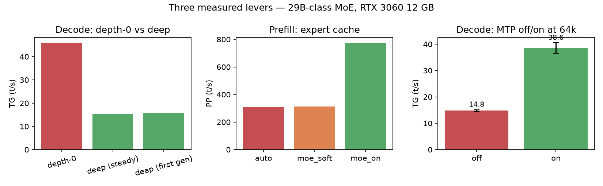

# Long-Context Local LLM Inference on a 12 GB RTX 3060: Measuring MTP, Prefill, and VRAM at 64k

**Research question.** How do prefill, decode, and memory behave when serving a
29B-class Mixture-of-Experts model at 64k context on a single 12 GB consumer GPU
— and which knobs actually move each one?

**Scope.** One model (Q4_K_M 29B-class MoE), one host (RTX 3060 12 GB,
i7-9700K, 32 GB), one serving build (`bcb85fc`), one 64k context, one fixed
long-prompt family. The MTP result is the live 29B profile; the controlled
expert-cache and depth-0 comparisons use the 28B bench sibling. These are
configuration-specific findings, not universal speedup estimates.

Every number below links to the table or raw trace behind it. Evidence labels —
**MEASURED**, **REGENERATED**, **REPRODUCIBLE**, **ESTIMATED**, **UNVERIFIED** —
are defined in [EVIDENCE.md](EVIDENCE.md). **No measured run is REPRODUCIBLE**
because the runner and coding harness are private; the tables are regenerated
from committed traces.

## Headline findings

| # | Finding | Configuration | Cost / caveat | Evidence |
|---|---|---|---|---|
| 1 | **MTP speculative decoding more than doubles deep-context decode at 64k: 14.79 → 38.56 t/s (+160.7%)**, while prefill is unchanged (−1.19%, inside the ~4% operational threshold). | Live 29B MTP profile, 10 runs/arm, ~57.9k prompt | **+993 MiB peak VRAM**, ~1.7 GiB host RAM; not REPRODUCIBLE (private runner) | **MEASURED + REGENERATED** — [mtp_ab.csv](results/mtp_ab.csv) |
| 2 | **Depth-0 `llama-bench` measures 46.0 t/s, but only ~15 t/s once a full 64k prompt is in front of it (~3× in this comparison).** Depth-0 is a valid baseline for model-only generation; it does not capture the long-context request path. | Depth-0 imported from the 28B bench sibling; deep row from a live server request | Different configurations; this is a measured gap, not a universal ratio | **MEASURED (imported + live)** — [deep_vs_depth0.csv](results/deep_vs_depth0.csv) |
| 3 | **The MoE expert cache is the prefill lever: 308 → 776 t/s (~2.5×) in the controlled short-context A/B.** At 64k, cache-off prefill collapses below 73 t/s, versus ~677–712 t/s with the cache on. | 28B bench sibling, 1k controlled A/B; 64k rows are sibling measurements | Spends spare VRAM; deep decode stays ~14–15 t/s; 64k no-cache is a timeout upper bound | **MEASURED (sibling) + REGENERATED** — [moe_cache.csv](results/moe_cache.csv) |



*Data: [mtp_ab.csv](results/mtp_ab.csv) ·
[deep_vs_depth0.csv](results/deep_vs_depth0.csv) ·
[moe_cache.csv](results/moe_cache.csv) · raw traces:
[data/raw/mtp/](data/raw/mtp/) · rebuild: `python scripts/build_results.py &&
python scripts/make_figures.py`. Panels come from different experiments; only the
MTP panel is the live 29B profile.*

*Also measured:* the 28B `ncmoe` optimum does **not** transfer to the 29B MTP
profile (`ncmoe=17` OOMs at load, `ncmoe=20` fits) —
[results/ncmoe_probe_29b.csv](results/ncmoe_probe_29b.csv); and end-to-end
coding on the shipped sampling is **19/33 runs = 57.6%** (run-level Wilson 95%
CI 40.8–72.8, which treats the 33 runs as independent; they are 11 tasks × 3,
and a task-clustered bootstrap gives 27.3–84.9%), with **6/11 tasks passing all
three runs and 4/11 never passing**, and 84.0% of individual test methods
passing — [results/coding_overall.csv](results/coding_overall.csv),
[results/coding_summary.csv](results/coding_summary.csv). *(MEASURED +
REGENERATED; not REPRODUCIBLE — the harness is private.)* Neither interval
estimates general performance on unseen coding tasks.

## MTP comparison at 64k


*Data: [mtp_ab.csv](results/mtp_ab.csv) · raw traces:
[data/raw/mtp/](data/raw/mtp/) · rebuild: `python scripts/build_results.py &&
python scripts/make_figures.py`. Live 29B MTP profile, 10 kept runs per arm,
interleaved `off → on → on → off`, cold prefill (`cache_n == 0`), ~57.9k-token
prompt. Decode 14.79 → 38.56 t/s (+160.7%, combined 95% CI ±4.58). Prefill
645 → 637 t/s (−1.19%). Cost: +993 MiB peak VRAM and ~1.7 GiB host RAM.
Acceptance 0.838 (sd 0.070).*


*Data: [mtp_runs.csv](results/mtp_runs.csv) · raw traces:
[data/raw/mtp/](data/raw/mtp/). The arms are **not paired** — every request has
a unique nonce — so no paired-difference interval is claimed.*

## Tested configuration

| Component | Value |
|---|---|
| GPU | NVIDIA RTX 3060, **12 GB** (12,288 MiB) |
| CPU / RAM | Intel i7-9700K, 8 cores / 8 threads / 32 GB |
| OS | Arch Linux, kernel 7.2.8 |
| GPU driver / power | 615.78.08; 170 W limit — **post-hoc capture, not the run-time record** |
| Model | `Qwen3.6-29B-REAP-Opus-Reasoning-Distill-MTP`, Q4_K_M |
| Architecture | sparse Mixture-of-Experts, ~29B total |
| Context | 64k (`-c 65536`) |
| Expert offload | `--n-cpu-moe 20` |
| Speculative decoding | `--spec-type draft-mtp --spec-draft-n-max 2` |
| KV cache | `turbo4` (K) / `turbo3` (V) |
| Expert cache | `--moe-cache on` |
| Build | `llama.cpp` (KV-cache fork, `turbo4`/`turbo3`) @ `bcb85fc3ae85efa0f5f392c6c880dfc524923860` |


*Schematic, not a data plot: the request path and the measured memory split
(11,588 MiB MTP-on peak vs 10,595 MiB off).*

**VRAM, not host RAM, is the binding constraint** — the KV cache is
VRAM-resident, so host RAM does not scale with context length. If your GPU is
not a 12 GB Ampere-class card, or your model is not this 29B MoE, treat the
magnitudes as a starting hypothesis rather than a prediction. Full host, model,
and flag detail: [HARDWARE-AND-RUNTIME.md](HARDWARE-AND-RUNTIME.md).

## What is and is not established

**Observed in this configuration** *(MEASURED + REGENERATED)*

- The *magnitudes* for this exact configuration: 64k context, `ncmoe=20`, MTP
  `n-max=2`, `turbo4`/`turbo3`, this build, this prompt family.
- MTP raised deep decode from 14.79 to 38.56 t/s while prefill stayed inside the
  operational noise threshold.
- The controlled sibling A/B showed a ~2.5× prefill gain from the expert cache;
  the live 29B `ncmoe=17` load probe failed while `ncmoe=20` loaded.
- End-to-end coding completion under the shipped sampling, reported as a
  run-level rate with a run-level Wilson interval, a task-clustered bootstrap
  interval, and task-level counts. These describe this fixed 11-task suite; they
  are not an estimate of general coding ability.

**Hypotheses, not findings** *(ESTIMATED / UNVERIFIED)*

- The *directions* may hold on other MoE models with constrained VRAM: depth
  matters, MTP helps decode, the expert cache helps prefill, memory optima do not
  transfer. This study does not establish that.
- Other GPUs, VRAM tiers, or multi-GPU setups; other stacks (vLLM,
  TensorRT-LLM, MLX); other quantizations or model families.
- 128k on the live profile — the 128k figures are bench-sibling estimates, not
  live 29B measurements.
- That MTP `n-max=2` is the optimum draft count, or that these magnitudes
  generalize to another corpus. Acceptance is content-driven.
- That throughput predicts correctness. The coding suite measures completion
  under hidden tests on 11 fixed tasks; neither the run-level nor the
  task-clustered interval projects to unseen coding tasks.

Full boundary of the claims: [LIMITATIONS.md](LIMITATIONS.md).

## Reproduce

```bash
# raw traces are committed under data/raw/ (see REPRODUCTION.md)
pip install -r requirements-dev.txt  # scripts + pytest
python scripts/build_results.py --raw data/raw --out results   # raw traces -> results/*.csv
python scripts/make_figures.py                                 # results/*.csv -> figures/*.png
python scripts/check_traceability.py --report results/traceability.txt
python scripts/manifest.py --check
python -m pytest -q
bash scripts/check_hygiene.sh
```

The traces can be audited from a fresh clone, but the original runner and coding
harness are **not published**, so the experiment cannot be independently
repeated from this repository alone. `scripts/reproduce_mtp_ab.py` publishes the
client-side MTP on/off **procedure** against two already-running servers; compare
directions and intervals, not the published magnitudes. Step-by-step detail and
the private-runner boundaries: [REPRODUCTION.md](REPRODUCTION.md).

## Links

| Resource | Where |
|---|---|
| Full article | [ARTICLE.md](ARTICLE.md) |
| Evidence labels, matrix, release checklist | [EVIDENCE.md](EVIDENCE.md) |
| Traceability gate output | [results/traceability.txt](results/traceability.txt) |
| Methodology and protocol | [METHODOLOGY.md](METHODOLOGY.md) |
| Hardware, model, and serving flags | [HARDWARE-AND-RUNTIME.md](HARDWARE-AND-RUNTIME.md) |
| Raw traces and traceability map | [data/raw/](data/raw/) · [data/traceability.md](data/traceability.md) |
| Result tables | [results/](results/) |
| Figures | [figures/](figures/) |
| Limitations | [LIMITATIONS.md](LIMITATIONS.md) |
| Data hygiene checklist | [DATA-HYGIENE.md](DATA-HYGIENE.md) |
| Citation metadata | [CITATION.cff](CITATION.cff) |
| License | [LICENSE](LICENSE) |

## The study in detail

Most local-LLM performance writing reports `llama-bench` prompt-eval and
token-generation at depth 0. Depth-0 is a valid baseline for model-only
generation throughput, but it does not capture the full long-context request
path; in this comparison it overstated deep decode by about 3×. An agent serving
real requests sees a large prompt (tens of thousands of tokens) and then
generates in its shadow. This study measures that path.

The live measurements come from the real request path, not a synthetic depth-0
benchmark; imported `llama-bench` rows are labelled as such in each figure's
provenance, and every generated table traces to a raw run or a sourced row.
The protocol in brief: `POST /v1/chat/completions` with `stream: true`,
`cache_prompt: false`, and a unique nonce per request (guaranteeing cold prefill
via `cache_n == 0`); arms interleaved in alternated then reversed block order;
warmups discarded and ≥5 kept runs per arm; mean and SEM reported, with a ~4%
operational threshold (a lab heuristic, not a confidence interval); and VRAM,
host RAM, GPU utilization, watts, and swap sampled per request. Full protocol
and rejected framings: [METHODOLOGY.md](METHODOLOGY.md).

| Path | Purpose |
|---|---|
| [ARTICLE.md](ARTICLE.md) | The flagship article (narrative + figures). |
| [METHODOLOGY.md](METHODOLOGY.md) | Measurement protocol, what makes a result real, rejected experiments. |
| [HARDWARE-AND-RUNTIME.md](HARDWARE-AND-RUNTIME.md) | Host, GPU, model, build, exact serving flags. |
| [LIMITATIONS.md](LIMITATIONS.md) | What this study does not establish. |
| [REPRODUCTION.md](REPRODUCTION.md) | Audit, regenerate, and procedure-reproduction boundaries. |
| [DATA-HYGIENE.md](DATA-HYGIENE.md) | The public-release checklist every figure must pass. |
| [data/traceability.md](data/traceability.md) | The map from every published number to its raw source. |
| `results/` | One CSV per experiment, each row traceable to a raw run. |
| `figures/` | Generated plots. |
| `scripts/` | Regenerate every CSV and figure from raw inputs. |

## License

Text and figures: CC BY 4.0. Scripts: MIT. See [LICENSE](LICENSE).
